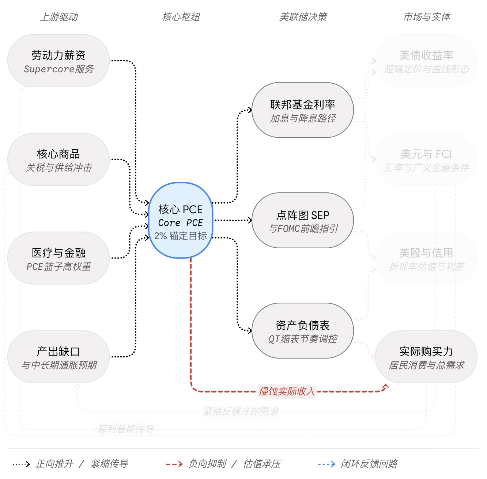

每月月中，当美国劳工统计局公布 CPI（消费者物价指数）的那一秒，全球美债、黄金、美元和纳斯达克指数都会瞬间剧烈跳动。

但一个反常识的事实是：**市场交易员最爱炒作 CPI，可真正决定美联储加息还是降息的“官方标尺”，却是月末才登场的另一个指标——核心 PCE（Core PCE，核心个人消费支出价格指数）。**

甚至在 2026 年下半年，当美国核心 CPI 显得相对温和时，核心 PCE 却顽固地停留在 3.1%–3.2% 的高位，直接迫使美联储推迟宽松甚至重启紧缩讨论。

这两个名字长得极其相似的通胀指标，究竟差在哪里？核心 PCE 内部装了什么？美联储又为什么非它不可？

---

## 一、 核心 PCE 与 CPI 的四大本质区别

虽然两者都用来衡量美国物价的涨跌，但它们背后代表了两种截然不同的统计哲学：**CPI 衡量的是“固定一篮子商品贵了多少”（生活成本视角），而 PCE 衡量的是“人们实际花出去的钱变多了多少”（真实消费视角）。**

具体而言，两者存在四个决定性的差异：

| 对比维度 | PCE（个人消费支出价格指数） | CPI（消费者物价指数） | 现实影响与背离原因 |
| --- | --- | --- | --- |
| **1. 发布机构** | 美国商务部经济分析局（BEA） | 美国劳工统计局（BLS） | 数据来源不同：PCE 采自企业端销售报表（GDP 核算口径），CPI 采自城镇家庭抽样问卷。 |
| **2. 权重调整频率** | **每季度动态更新** | 每年更新一次（相对滞后） | **替代效应**：牛肉涨价后人们改吃鸡肉，PCE 会立刻调低牛肉权重，更贴近真实支出；CPI 仍按老权重算，容易高估通胀。 |
| **3. 统计覆盖范围** | **全口径消费**（含第三方代付） | **仅限城镇居民自付支出** | **医疗权重差距巨大**：PCE 涵盖雇主和政府（如 Medicare）代付的医疗保险，医疗权重高达 **16%+**；CPI 仅算个人自付医药费，权重仅约 **7%**。 |
| **4. 住房（房租）权重** | 较低（约 **15%–16%**） | 极高（超过 **30%**） | CPI 极易被单一房租数据“绑架”；PCE 结构更均衡，金融服务、医疗等权重更高。 |

此外，**PCE 还会根据后续更完善的商业普查数据进行历史回溯修订**，而 CPI 除季节性调整外基本不修改历史数字。对需要复盘经济周期的央行而言，能不断修正误差的 PCE 显然更可靠。

---

## 二、 核心 PCE 的内部构成：拆解通胀的三大引擎

在计算 PCE 时，统计局会先剔除受气候、地缘冲突影响剧烈、且央行货币政策无法控制的**食品（约 7%）**和**能源（约 4%）**，剩下的约 **89%** 便是**核心 PCE**。

如果把核心 PCE 进一步解剖，主要由三大板块构成：

### 1. 核心商品（Core Goods，占比约 22%–25%）

涵盖汽车、家具、家电、服装、电子产品等耐用品与非耐用品。

* **驱动逻辑**：高度受全球供应链、贸易关税、汇率以及库存周期影响。
* **近年特征**：在供应链顺畅期，核心商品往往处于微幅通缩状态，是压低通胀的功臣；但一旦出现关税壁垒或供应链重构，商品价格就会重新转正并推高整体核心 PCE。

### 2. 住房服务（Housing Services，占比约 15%–16%）

主要包括实际租金以及“业主等价租金（OER，即假设房主把自己的房子租出去能收多少钱）”。

* **驱动逻辑**：由于租约通常一年一签，住房通胀具有极强的**滞后性**（往往滞后市场实时房租 6–12 个月）。虽然它在 PCE 中的权重只有 CPI 的一半，但依然是决定通胀底部的稳定器。

### 3. 非住房核心服务（Supercore PCE，占比约 50%+）

这是核心 PCE 中**体量最大、粘性最强、也是美联储主席最为关注的“超级核心通胀”**，涵盖：

* **医疗保健服务**（权重最大单项，受医保报销定价与医护人力成本驱动）；
* **金融服务与保险**（含银行手续费、资产管理与投资顾问费——股市上涨时，按资产规模比例收取的资管费水涨船高，甚至会反向推高 PCE）；
* **交通运输、餐饮住宿与休闲娱乐**（高度依赖一线服务业工人的薪资增速）。

---

## 三、 为什么我们需要“核心”PCE，而不是直接看整体物价？

很多普通人会质疑：“老百姓每天都要吃饭、加油，把食品和能源剔除掉的‘核心通胀’，难道不是掩耳盗铃吗？”

如果站在个人生活感受的角度，这种质疑完全合理；但如果站在**中央银行制定货币政策**的角度，盯着“核心”指标却是避免政策灾难的必要条件：

1. **货币政策管不了天气和战争**
中东地缘冲突导致国际油价暴涨，或者一场飓风摧毁了农作物导致菜价飙升，这些属于**短期供给冲击**。美联储加息既不能变出更多石油，也不能让农作物增产。如果央行因为油价短期飙升而盲目大幅加息，等几个月后油价自然回落，高利率已经把实体经济和就业市场砸进了衰退。
2. **捕捉真正具有“粘性”的底层趋势**
食品和能源价格波动极快（均值回归属性强），而理发、看病、房租、律师咨询等**服务价格一旦涨上去就很难跌下来**，因为它们背后绑定的是人工工资。剔除噪音后的核心 PCE，才能过滤掉短期干扰，看清经济内部是否已经形成“工资上涨 → 物价上涨 → 要求更高工资”的**螺旋式恶性通胀**。
3. **预测未来整体通胀的更好指标**
大量宏观实证研究表明，过去 12 个月的核心 PCE 走势，对**未来 1–2 年整体 PCE 走势的预测能力，远强于整体 PCE 自身**。央行调节利率需要 4 到 6 个季度才能在实体经济中完全生效，因此美联储必须盯着最具前瞻预测价值的指标。

---

## 四、 核心 PCE 与美联储 2% 通胀目标的深层绑定

自 2000 年起，美联储正式放弃将 CPI 作为主要通胀参照系，转而锚定 PCE；2012 年，时任美联储主席伯南克进一步确立了**长期对称 2% 的 PCE 通胀目标**。

为什么美联储把自己的政策信誉死死锚定在“核心 PCE = 2%”这根准绳上？

### 1. 为什么是“2%”，而不是“0%”？

* **留出安全缓冲垫（避免通缩陷阱）**：物价持续下跌（通缩）比温和通胀更可怕——消费者会因为“明天更便宜”而推迟消费，企业利润萎缩并裁员，最终陷入债务通缩螺旋。2% 的正通胀为经济留出了防通缩的安全边际。
* **补偿统计偏差与保留降息空间**：即便经过动态权重调整，统计指标仍存在约 0.2%–0.5% 的质量改进高估偏差，2% 的名义目标对应的真实物价涨幅接近 1.5% 左右。同时，2% 的通胀率能让正常时期的名义利率维持在 3%–4% 区间，一旦危机爆发，美联储手里才有足够的降息弹药。

### 2. “对称性目标”与泰勒规则的传导机制

美联储强调的 2% 是**对称目标（Symmetric Target）**——意味着核心 PCE 长期高于 2%（如停留在 3% 以上）和长期低于 2% 同样不可接受。

在美联储内部参考的泰勒规则（Taylor Rule）中，核心 PCE 偏离 2% 的缺口（$\pi_t - 2\%$）直接决定了名义利率的基准高度：

* 当核心 PCE 持续高于 2% 且环比维持在 0.3%（对应年化超 3.6%）的危险区间时，即便失业率尚未恶化，美联储也必须将政策利率维持在高于中性利率的**限制性区间**，甚至被迫重启加息，直到把总需求压回冷却轨道；
* 只有当核心 PCE 环比连续回落至 **0.17%** 左右（对应年化 2% 的合意节奏），且占据半壁江山的“非住房核心服务”明显降温时，美联储才会真正打开降息闸门。

---

## 结语

如果把美国经济比作一辆高速行驶的汽车，**CPI 就像是车窗外的阵风风速表**，敏感、夸张、容易被一时的颠簸放大；而**核心 PCE 则是仪表盘上的发动机水温表**，它过滤了路面的震动，直接反映引擎内部是否正在过热。

下一次当你看到财经新闻在月末刷屏“美国核心 PCE 公布”时，不妨重点看三个数字：**核心 PCE 同比是否向 2% 靠拢、环比是否控制在 0.2% 以内，以及非住房服务分项是否松动**——因为这三个数字，正直接书写着全球资本市场下一个季度的流动性剧本。
