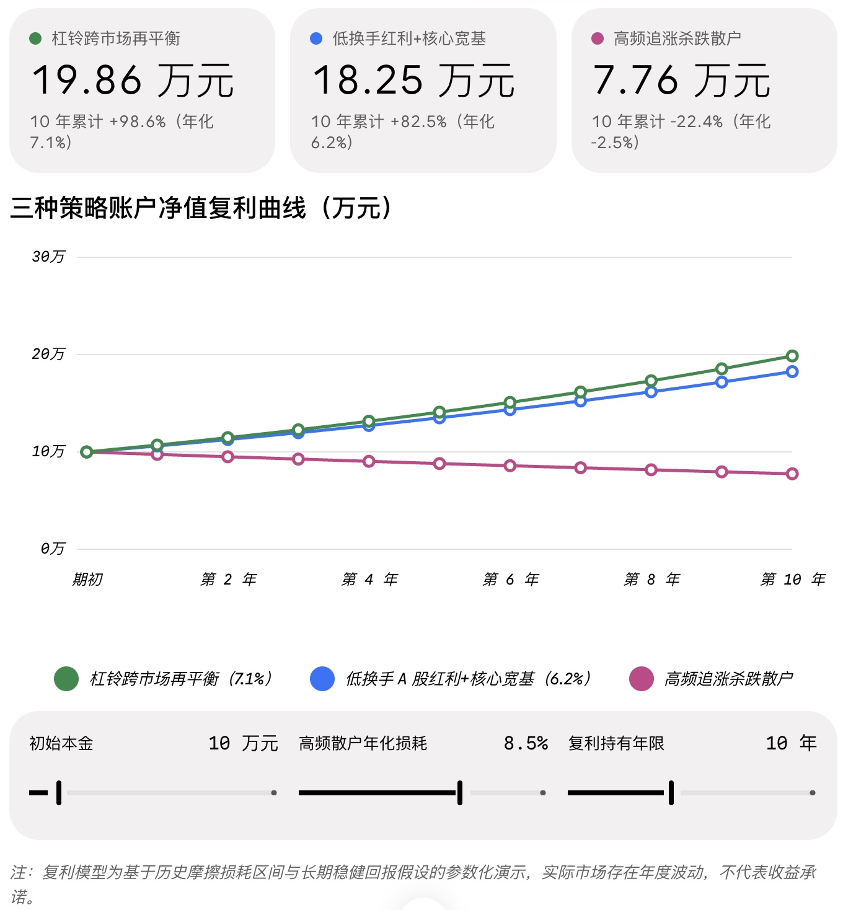
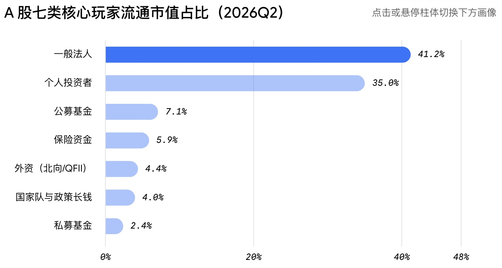

> **核心判断：** A 股并不是一个单一逻辑定价的“价值发现市场”，而是一个**由“产业资本与长钱”压舱、由“高换手情绪资金”主导日常波动、各路参与者在截然不同的考核函数与利益诉求下展开多维博弈的复杂生态**。普通散户长期亏损的根源，并非不够勤奋，而是用最脆弱的个人资金属性，卷入了信息、算力与筹码均处于绝对劣势的负和博弈战场。

---

## 一、 资金结构底盘：筹码沉淀与流量交易的“双层倒挂”

理解 A 股所有异象的起点，是看清其底层资金的**存量分布**与**流量贡献**之间极其剧烈的结构倒挂。

### 1. 存量筹码：四大阵营主导的“重产业、轻机构”格局

截至 2026 年二季度末，按流通市值口径统计，A 股筹码由四大类资金构成，呈现鲜明的“产业资本一家独大、个人持仓偏高、专业机构体量偏小”特征：

* **一般法人（产业资本）占 41.2%：** 由控股股东、国资集团及上市公司实控人构成，是全市场体量最大的筹码持有者，但绝大部分股权处于长期锁定或非活跃交易状态。
* **个人投资者占 35.0%：** 账户总数突破 2.39 亿户（占全市场账户比例超 99.76%），涵盖从不足万元的长尾散户到数亿元体量的顶级游资与牛散。
* **境内专业机构合计占 19.4%：** 内部高度碎片化，包括公募基金（约 7.1%，持股市值约 7.52 万亿元）、保险资金（约 5.9%，约 5.7 万亿元）、私募基金（约 2.4%，约 2.32 万亿元）以及社保、养老金、券商自营等其他机构（约 4.0%）；若计入借道宽基 ETF 的间接持仓，以中央汇金为代表的“国家队”整体体量约 8.5–9.5 万亿元。
* **外资（北向资金与 QFII）占 4.4%：** 存量占比不高，但因进出透明且代表全球定价视角，对核心白马板块具有显著的边际定价影响力。

### 2. 流量倒挂：三成筹码制造七成成交

存量决定底部，流量决定波动。持股超四成的一般法人极少参与日常买卖，而持股市值仅占 35.0% 的个人投资者，却贡献了全市场 **60%–70% 的日均成交额**（成熟美股市场散户成交占比通常低于 10%）。在账户内部，这种活跃度进一步高度集中——约 30% 的高频交易个人账户贡献了散户群体六至七成的成交量，50 万元以下中小散户年均换手率超过 300%，是机构（约 25%）的 12 倍。

### 3. 全口径资金流约束：从“系统性抽血”迈向“零轴紧平衡”

观察市场整体能否产生普惠回报，必须看二级市场公众流通盘的真实净现金流：

$$\text{公众流通盘真实净流向} = (\text{公众实得分红} + \text{股票回购}) - (\text{一级股权融资} + \text{重要股东净减持} + \text{交易摩擦})$$

* **历史抽血期（以 2021 年为例）：** 当年股权融资达 1.79 万亿元，超过 1.55 万亿元的现金分红总额；叠加重要股东减持、高频交易税费与大股东分红截留，二级市场公众流通盘年化净流出约 1.79 万亿元，处于典型的负和失血状态。
* **制度拐点期（2024–2025 年）：** 新“国九条”落地后，现金分红大幅反超股权融资（2025 年现金分红达 2.63 万亿元，股权融资为 1.02 万亿元，两年多累计分红接近 7 万亿元）。但考虑到央国企与大股东持股集中导致约 50% 的现金分红回流实控人账户，叠加 250–350 万亿元年成交额催生的 0.25–0.35 万亿元刚性交易摩擦，**目前 A 股公众流通盘整体仅处于“刚刚止血、零轴紧平衡”状态**，尚未形成类似美股依靠高比例注销式回购带来的普惠资金顺风。

---

## 二、 核心玩家用户画像与利益诉求全景拆解

A 股的定价逻辑之所以常令初学者困惑，是因为同一张牌桌上的七类玩家，**资金来源不同、考核周期不同、对“赢”的定义完全不同**。

| 玩家类型 | 资金属性与久期 | 核心利益诉求（目标函数） | 典型行为与持仓偏好 | 核心优势与软肋 |
| --- | --- | --- | --- | --- |
| **一般法人（产业资本）** | 自有长期股权 / 国资；久期数年至永久 | 控股权稳固、低成本再融资、国资保值与市值考核；部分民企股东追求高位套现变现 | 低位回购增持，泡沫高位减持、发可转债或定增 | **优势：** 掌握最底层经营真相 **软肋：** 筹码体量大，退出高度依赖牛市流动性 |
| **国家队与政策长钱** | 政策性/公共长期资金；无短期赎回压力 | 守住金融系统性风险底线（汇金/证金）；长期保值增值覆盖养老缺口（社保/养老） | 逆周期左侧托底，重仓大金融与沪深 300 等核心宽基 ETF | **优势：** 资金无限久期、无排名焦虑 **软肋：** 承担托底职能，难以灵活追逐小盘弹性 |
| **保险资金** | 保费长钱；存在 2.5%–3.5% 刚性负债成本 | 覆盖负债成本的同时，压低当期利润表的净值波动 | 持续配置银行、电力、交运、煤炭等高股息低波蓝筹 | **优势：** 现金流持续稳定流入 **软肋：** 受偿付能力与会计准则严格约束 |
| **公募基金** | 大众开放式申赎受托资金；顺周期波动大 | 扩大管理规模（AUM）赚取管理费；年度/季度相对排名不掉队 | 主动派深度抱团高景气成长赛道；被动派借宽基/行业 ETF 承接资金 | **优势：** 深度投研覆盖产业一线 **软肋：** 面临“高位申购、低位赎回”的负债端魔咒 |
| **私募基金（主观/量化）** | 高净值募资；普遍带净值预警与止损线 | 高夏普绝对收益与超额业绩报酬（Carry）；严控回撤防清盘 | 主观派分化为深度价值或集中趋势；量化派高频全市场覆盖中小盘 | **优势：** 机制灵活，量化具备算力与微结构碾压优势 **软肋：** 预警线迫使其在极端暴跌时被动降仓 |
| **外资（北向/QFII）** | 全球资产配置资金；受美债利率与汇率影响 | 全球权益市场横向比价下的风险调整后超额收益 | 配置型偏爱高 ROE 核心白马；交易型围绕宏观预期做波段 | **优势：** 全球跨市场估值视野 **软肋：** 面临地缘、汇率与本土草根信息隔阂 |
| **个人投资者与游资** | 自有闲钱或高息两融资金；90% 账户低于 50 万元 | 散户渴求“以小博大”的快速翻倍与情绪反馈；游资追求短期连板接力套现 | 偏爱中小微盘题材股、热点消息与短期 K 线突破；换手极高 | **优势：** 无考核、无赎回、进出无冲击成本 **软肋：** 缺乏定价锚，易受处置效应与羊群效应支配 |

### 几类关键玩家的深层利益机制剖析

1. **险资为何成为红利资产最坚定的“压舱买手”？**
在新金融工具会计准则（IFRS 9）全面落地后，股票公允价值波动会直接冲击险企当期净利润。为了平滑利润表并覆盖刚性保单成本，险资将大量权益仓位划入 FVOCI 账户。这一制度诉求，决定了险资对“高股息、低波动、商业模式稳固”的央国企蓝筹存在长期刚性配置需求。
2. **公募基金为何必然出现“赛道抱团”与“底部踩踏”？**
公募基金经理的激励核心是**相对排名**而非绝对回报。在牛市中，若大家都在买 AI 或新能源而自己不买，跑输基准两个季度就会面临规模流失甚至丢掉岗位；若一起抱团下跌，只要相对排名不靠后则安全无虞。同时，由于基民天然习惯在净值高点蜂拥申购、在熊市低点恐慌赎回，基金经理往往被迫“高买低卖”，客观上成为市场趋势的放大器。
3. **量化私募与游资的真实利润来源是什么？**
两者都不依赖企业长期盈利增长，本质上都在赚取**交易对手的非理性情绪与流动性溢价**。游资通过制造涨停板赚钱效应吸引散户跟风接力，再于情绪高潮期派发筹码；量化私募则利用高频算法和统计模型，在全市场数千只中小盘股票的日内波动与隔夜反转中持续收割微结构定价偏差。**只要市场存在高比例、高换手的非理性散户，量化与游资的盈利土壤就会长期存在。**

---

## 三、 利益博弈全景：双轨分化与周期收割链条

当上述七类玩家带着完全不同的诉求进入同一个市场，A 股演化出了两条核心博弈规律。

### 1. 平行宇宙：A 股已分裂为“正和慢轨”与“负和快轨”

全市场名义上的“零轴紧平衡”掩盖了剧烈的内部撕裂，如今的 A 股实质上是两个游戏规则截然不同的市场：

* **轨道一：红利蓝筹与核心宽基（正和长钱生态）。** 参与者以国家队、险资、社保、配置型外资和央国企产业资本为主。在监管强制分红与市值管理考核下，这一轨道跑通了“稳定盈利 → 3%–5% 现金分红/回购 → 低换手复利”的正向闭环，资金利益高度一致。
* **轨道二：中小微盘与题材概念（负和博弈生态）。** 参与者以高频散户、游资、量化私募以及存在强烈套现诉求的原始股东为主。该板块整体分红率微薄、再融资与减持意愿强、换手率极高，扣除税费、佣金与滑点后资金池持续净流出。这里的核心逻辑不是分享企业成长，而是“击鼓传花”式的存量互割。

### 2. 牛熊周期中的跨维度筹码转移

A 股的财富转移并非随机发生，而是沿着严格的时间维度梯度完成——**长周期资金收割中周期资金，中周期资金与算力资金收割短周期情绪资金**：

1. **熊市绝望底（筹码向压舱石集中）：** 散户因深度套牢或恐慌割肉离场，公募遭遇持续赎回被动卖出，带止损线的私募被迫降仓；此时国家队、险资与产业回购资金在左侧安静承接低估筹码。
2. **结构启动与主升浪（定价层主导溢价）：** 政策或产业景气拐点出现，外资与公募率先围绕主线赛道抱团推升估值，量化推高成交活跃度，局部赚钱效应开始发酵。
3. **情绪泡沫顶（筹码向情绪层派发）：** 赚钱效应破圈引发增量散户集中开户进场，游资借题材制造连板幻觉，两融杠杆迅速攀升；此时产业资本通过减持、大宗交易与再融资高位套现，长钱与先知资金有序兑现，留下大量高成本散户在高位站岗，进入漫长阴跌期。

---

## 四、 A 股散户的最佳投资策略：放弃博弈，把散户活成“微型险资”

面对如此悬殊的牌桌结构，2025 年统计显示 A 股散户整体亏损比例高达 81.1%。小资金想要打破“七亏二平一赚”的宿命，唯一的出路不是学更多 K 线技术或打听内幕消息，而是**进行彻底的战略升维：主动退出“负和快轨”，把散户独有的“无考核、无赎回、无清盘线、无冲击成本”特质，转化为全市场唯一的不对称优势**。

### 1. 阵营选择：全面撤出题材博弈，站队“压舱石层”

拒绝把主力资金投入高估值、低分红、高换手、大股东频繁减持的纯故事股。将 A 股权益底仓锚定在**中证红利低波、央国企高股息及沪深 300 / 中证 A500 核心宽基**上。这相当于用极低成本搭乘险资、社保与国家队的顺风车，先通过每年 3%–5% 的现金股息率拿到“不靠接盘侠也能回本”的底薪。

### 2. 工具降维：用低费率 ETF 替代重仓单押个股

A 股单年回撤超 30% 的个股占比常年过半，叠加财务造假、业绩变脸与退市出清风险，普通人重仓单只个股容错率极低。改用年费率仅 0.15%–0.5% 的宽基与红利 ETF，既能瞬间分散个股“踩雷”风险，又能借助指数定期调样实现自动“剔弱留强”。

### 3. 成本革命：强行把年换手率从 300% 压缩至 50% 以下

高频散户每年仅显性税费、佣金与追涨杀跌滑点就会吞噬 **8%–10%** 的本金——这相当于还没开始投资，每年先背上一笔高利贷。**减少交易频率本身就是普通人最确定、零门槛的超额收益来源。** 将看盘频率从每天盯分时图压缩至每周或每月复盘一次，切断盘面情绪对决策的干扰。

### 4. 组合架构：以“杠铃防御 + 跨市场多元配置”破局低贝塔

A 股单一市场长期呈现“低贝塔、高波动”特征，最佳解法不是试图精准预测每次牛熊顶底，而是通过跨资产配置从结构上平滑周期：

* **防守安全垫（20%–30%）：** 配置货币基金、国债逆回购或中短债基金。它的核心价值是保证生活急用钱时绝不在熊市底部被迫割肉，并在市场出现极端流动性踩踏时提供抄底弹药。
* **A 股红利低波底仓（25%–35%）：** 获取稳定现金流与政策鼓励分红的制度红利，充当权益组合的压舱石。
* **跨市场与避险资产（25%–35%）：** 借道合规 QDII 基金配置海外成熟市场宽基（分享其高比例注销式回购带来的长期现金顺风），并搭配 5%–10% 黄金 ETF 对冲地缘与汇率不确定性。
* **A 股宽基逆向弹性仓（10%–20%）：** 仅在核心宽基估值处于历史低位、市场普遍悲观时采用定投或分批建仓方式介入，赚取周期均值回归的赔率钱。

### 5. 执行纪律：逆向定投、机械再平衡与绝对零杠杆

* **用制度对抗人性：** 提前设定好上述四大资产的目标权重，每半年或每年执行一次**机械再平衡**——将涨超目标比例的资产强制卖出兑现，补给跌破比例的低估或防守资产，用机械规则把散户“追涨杀跌”的本能彻底反过来执行。
* **死守零杠杆铁律：** 绝不使用融资融券、场外配资或消费贷炒股。杠杆一旦加上，强制平仓线就会瞬间剥夺散户唯一拥有的“无限时间久期”优势，让你在黎明前的最后一次暴跌中永久出局。
* **回归主业现金流：** 对绝大多数本金在 50 万元以下的中小投资者而言，把时间投入到提升主业收入和持续储蓄定投上，其确定性财富增量远远超过在 K 线图里搏杀短期波动。

---

在 A 股这个多维混战的生态里，真正的胜负往往在下单之前就已经注定：当你试图在游资与量化的主场里赚快钱时，你就是流动性与手续费的贡献者；而当你主动降频、放弃杠杆、借道低费率 ETF 与跨市场配置站到长钱同一侧时，市场原本最残酷的高波动，反而会转化为不断为你提供廉价筹码的复利朋友。

深度报告，请参考[A 股市场生态深度分析报告：资金结构、玩家画像、利益博弈与散户生存法则](https://a11.world/reports/2026-11-27-a-%E8%82%A1%E5%B8%82%E5%9C%BA%E7%94%9F%E6%80%81%E6%B7%B1%E5%BA%A6%E5%88%86%E6%9E%90%E6%8A%A5%E5%91%8A-%E8%B5%84%E9%87%91%E7%BB%93%E6%9E%84-%E7%8E%A9%E5%AE%B6%E7%94%BB%E5%83%8F-%E5%88%A9%E7%9B%8A%E5%8D%9A%E5%BC%88%E4%B8%8E%E6%95%A3%E6%88%B7%E7%94%9F%E5%AD%98%E6%B3%95%E5%88%99)
